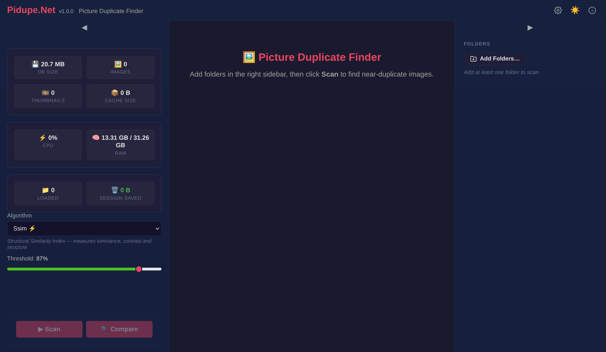

# PidupeDotNet


[](https://hub.docker.com/r/gafda/pidupe-net)

**PidupeDotNet** is a modern, high-performance image deduplication utility built on .NET 10 and Blazor Server. It identifies duplicate or near-duplicate image files using 7 comparison algorithms — CLIP, LPIPS, SSIM, pHash, dHash, Histogram, and MSE — with optional GPU acceleration.



> 📦 **Docker image available on Docker Hub:** [hub.docker.com/r/gafda/pidupe-net](https://hub.docker.com/r/gafda/pidupe-net)

---

## Features

- **7 Comparison Algorithms:** CLIP, LPIPS, SSIM, pHash, dHash, Histogram, MSE — ordered by accuracy. Custom mode combines any algorithms.
- **GPU Acceleration:** Optional CUDA/OpenCL acceleration with automatic CPU fallback.
- **Selective Folder Scanning:** Catalog all folders but scan/compare only those you check. Uncheck folders to exclude them without removing them.
- **Collapsible Folder Tree:** Folder paths are presented as a path-compressed tree with tri-state parent checkboxes, tree connector lines, and aggregate image counts.
- **Dark & Light Themes:** Toggle between dark and light modes with persistent preference.
- **High Performance:** Multi-core async processing for fast scanning of large libraries.
- **Mirror and Rotation Detection:** Detects horizontally/vertically flipped and rotated duplicates.
- **Rich EXIF Extraction:** Camera model, date taken, GPS coordinates, lens info, orientation via MetadataExtractor.
- **Persistent State:** Scan data, ignored pairs, and session history are preserved across sessions.
- **Docker Ready:** Pre-built images for both x64 and ARM64 (Raspberry Pi 4/5) with optional GPU passthrough.
- **Connection Resilience:** Automatic reconnection with user notification when the server disconnects.

---

## Getting Started with Docker

The recommended way to run PidupeDotNet is via the pre-built Docker image on [Docker Hub](https://hub.docker.com/r/gafda/pidupe-net).

### Prerequisites

- [Docker](https://docs.docker.com/get-docker/) or [Podman](https://podman.io/getting-started/installation)
- Optional: NVIDIA GPU + drivers on the host for GPU-accelerated algorithms (pHash, SSIM)
- Optional: CUDA Toolkit 12.x + cuDNN 9.x on the host for GPU acceleration of CLIP and LPIPS — see [GPU Setup](#gpu-setup)

### Quick Start

```bash
docker run -d \
  --name pidupe-net \
  -p 8008:8008 \
  -v /path/to/your/photos:/photos:ro \
  -v pidupe-data:/data \
  gafda/pidupe-net:latest
```

Then open your browser at `http://localhost:8008`.

> ⚠️ **Read-only volume warning:** The `:ro` flag mounts your photo folder as **read-only**. This prevents PidupeDotNet from deleting or renaming any files on disk. If you want to allow in-app deletion or renaming of image files, remove the `:ro` flag:
>
> ```bash
> -v /path/to/your/photos:/photos
> ```
>
> Only do this if you intend to allow the application to modify your files directly.

### Available Tags

| Tag | Architecture | Description |
|-----|-------------|-------------|
| `latest` | amd64 + arm64 | Latest stable release |
| `1.1.0` | amd64 + arm64 | Specific version |

Both tags are multi-arch manifest lists — Docker and Podman automatically pull the correct image for your host architecture.

---

## Volume Configuration

| Volume | Container Path | Purpose |
|--------|---------------|---------|
| Your photo library | `/photos` | The folder PidupeDotNet will scan |
| Persistent data | `/data` | Database, cache, and app state |

You can mount multiple photo subfolders if needed:

```bash
docker run -d \
  --name pidupe-net \
  -p 8008:8008 \
  -v /mnt/nas/photos:/photos/photos:ro \
  -v /mnt/nas/camera-roll:/photos/camera-roll:ro \
  -v pidupe-data:/data \
  gafda/pidupe-net:latest
```

> ⚠️ **Read-only volume warning:** All volumes above use `:ro` (read-only). File deletion and renaming from within the app will be blocked. Remove `:ro` on any mount where you want to allow modifications.

---

## GPU Setup

PidupeDotNet has two independent GPU acceleration paths. Both are optional — the app always falls back to CPU gracefully.

| Mode | Algorithms | Host Requirement |
|------|-----------|-----------------|
| **CUDA/OpenCL** | pHash, SSIM | NVIDIA/AMD GPU + drivers |
| **ONNX CUDA** | CLIP, LPIPS | NVIDIA GPU + CUDA Toolkit 12.x + cuDNN 9.x |

The NVIDIA driver alone is **not sufficient** for CLIP and LPIPS GPU acceleration. You must also install the CUDA Toolkit libraries on the **host machine**:

```bash
# Fedora / RHEL / Bazzite
sudo dnf install cuda-cudart-12-6 libcublas-12-6 libcufft-12-6 libcurand-12-6 libcusparse-12-6 libcudnn9-cuda-12

# Ubuntu / Debian
sudo apt install cuda-toolkit-12-6 libcudnn9-cuda-12
```

If CUDA libraries are missing, CLIP and LPIPS fall back to CPU automatically with a warning in the logs.

---

## GPU Passthrough

The container image is GPU-agnostic — GPU drivers are injected at runtime by the host.

| GPU Vendor | Docker flag | Podman flag |
|------------|-------------|-------------|
| **NVIDIA** | `--gpus all` | `--device nvidia.com/gpu=all` (CDI) |
| **AMD** | `--device /dev/kfd --device /dev/dri` | `--device /dev/kfd --device /dev/dri` |
| **Intel** | `--device /dev/dri` | `--device /dev/dri` |

### NVIDIA (Docker)

```bash
docker run -d \
  --name pidupe-net \
  -p 8008:8008 \
  --gpus all \
  -v /path/to/your/photos:/photos:ro \
  -v pidupe-data:/data \
  gafda/pidupe-net:latest
```

### NVIDIA (Podman, CDI)

```bash
podman run -d \
  --name pidupe-net \
  -p 8008:8008 \
  --device nvidia.com/gpu=all \
  -v /path/to/your/photos:/photos:ro \
  -v pidupe-data:/data \
  gafda/pidupe-net:latest
```

### AMD (Docker or Podman)

```bash
docker run -d \
  --name pidupe-net \
  -p 8008:8008 \
  --device /dev/kfd --device /dev/dri \
  -v /path/to/your/photos:/photos:ro \
  -v pidupe-data:/data \
  gafda/pidupe-net:latest
```

### Intel (Docker or Podman)

```bash
docker run -d \
  --name pidupe-net \
  -p 8008:8008 \
  --device /dev/dri \
  -v /path/to/your/photos:/photos:ro \
  -v pidupe-data:/data \
  gafda/pidupe-net:latest
```

> ⚠️ **Read-only volume warning:** All examples above use `:ro` on the photo mount. To enable in-app file deletion or renaming, remove the `:ro` suffix from the `-v` flag for your photo folder.

---

## Docker Compose

A minimal `docker-compose.yml` for CPU-only usage:

```yaml
services:
  pidupe-net:
    image: gafda/pidupe-net:latest
    container_name: pidupe-net
    ports:
      - "8008:8008"
    volumes:
      - /path/to/your/photos:/photos:ro   # Remove :ro to allow file deletion/renaming
      - pidupe-data:/data
    restart: unless-stopped

volumes:
  pidupe-data:
```

For GPU passthrough, add the appropriate device or deploy section for your vendor. See the [GPU Passthrough](#gpu-passthrough) section above.

---

## ARM64 (Raspberry Pi 4/5)

Pull and run the ARM64 image directly:

```bash
docker run -d \
  --name pidupe-net \
  -p 8008:8008 \
  -v /path/to/your/photos:/photos:ro \
  -v pidupe-data:/data \
  gafda/pidupe-net:1.1.0
```

> Note: CLIP and LPIPS run on CPU on ARM64 as ONNX CUDA is not supported on this architecture.

---

## How it Works

1. **Discover** — Recursively scan image files across your selected folders.
2. **Extract Metadata** — Read resolution, format, EXIF data, camera model, and date taken from each file.
3. **Compute Hashes** — Generate 64-bit DCT perceptual hash and difference hash per image.
4. **Compare** — Run the selected algorithms to score visual similarity between image pairs.
5. **Review** — Side-by-side comparison UI with one-click delete, swap, or ignore.

---

## License

Distributed under the **GPL v3.0 License**. See `LICENSE` for details.